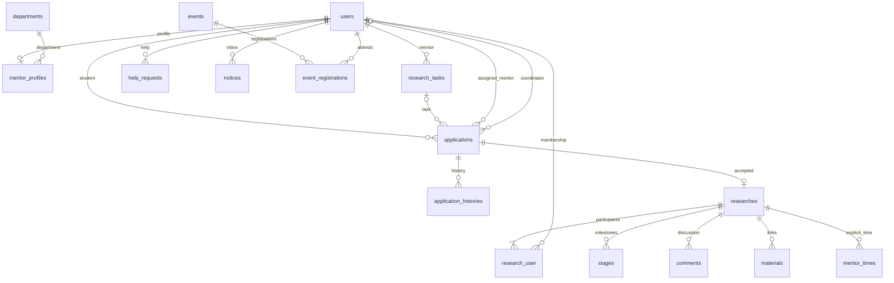

# Архитектура первой версии

## Стек и допущения

Laravel 12 / PHP 8.4, Blade и PostgreSQL 17. Одно приложение, серверная сессия в БД, файловый JavaScript без клиентского хранилища заявок или авторизации. Ответы и формы рендерятся сервером; основные сценарии работают без JavaScript. JavaScript отвечает за мобильное меню, подтверждения и повторное нажатие кнопок. PostgreSQL выбран из разрешённых в ТЗ СУБД; SQLite не подменяет рабочую или тестовую базу.

Открытые страницы доступны гостям. Регистрация даёт только роль студента. Учебные записи помечены; официальные контакты, документы и новости не сочинены. Университетские учётные записи и SMTP — отдельные будущие интеграции. Даты интерфейса, формы мероприятий и соединение PostgreSQL используют `Europe/Moscow`.

## Маршруты

| Группа | GET | Изменяющие действия |
|---|---|---|
| Публичные | `/`, `/about`, `/research`, `/research/match`, `/research/{id}`, `/mentors`, `/mentors/{id}` | Нет |
| События | `/events`, `/events/{id}` | POST / DELETE `/events/{id}/register` |
| Материалы | `/knowledge`, `/articles/{id}`, `/templates/{kind}` | Только через управление |
| Авторизация | `/login`, `/register` | POST `/login`, `/register`, `/logout` |
| Кабинет | `/dashboard?tab=…`, `/idea` | PATCH `/profile`, `/mentor-profile`; POST `/idea`, `/help`, `/notices/read` |
| Заявки | `/applications/{id}` | POST `/research/{id}/apply`, `/applications/{id}/transition`, `/applications/{id}/assign` |
| Исследование | `/workspace/{id}` | POST comments, materials, stages, participants, time; PATCH workspace и stages |
| Сопровождение | Вкладка `help` | POST `/help/{id}/answer` |
| Управление | `/manage/{section}`, `/manage/{section}/create`, `/manage/{section}/{id}/edit` | POST / PUT для записи |
| Настройки | `/manage/settings`, `/manage/statistics` | POST `/manage/settings` |
| Отдельная публикация | `/results/{id}` | POST `/workspace/{id}/consent`, `/workspace/{id}/publish` |

`section`: tasks, mentors, events, contents, departments. Фильтры каталога, тип события, календарный месяц, поиск и пагинация кодируются в GET-параметрах. Неизвестные разделы дают 404; недостаточные права — 403. Изменяющих GET-запросов нет.

## Модель данных

`contents` хранит knowledge, news, faq и document с независимой публикацией и пометкой примера. `settings` хранит подтверждённые контакты, пояснения и необязательный срок ответа. `researches` хранит формат результата, научную оценку, отдельный публичный текст и состояние рукописи. `research_user` хранит индивидуальное согласие на публикацию.

Данные не удаляются из кабинетов при паузе или закрытии набора. Вместо удаления публичного содержимого администратор снимает публикацию. Файлы исследований в первой версии не загружаются: `materials` хранит проверенные HTTP(S)-ссылки.

## Переходы заявок и права

| Роль | Из состояния | В состояние | Условие |
|---|---|---|---|
| Студент — автор | new, reviewing, clarification | withdrawn | Собственная заявка |
| Студент — автор | clarification | new | Содержательное уточнение; наставник сбрасывается, координатор рассматривает повторно |
| Организатор | new, reviewing, clarification | reviewing | Назначен доступный наставник; можно переназначить до решения |
| Организатор | new, reviewing, clarification | clarification, rejected | Пояснение минимум 10 символов |
| Назначенный наставник | reviewing | accepted, clarification, rejected | Только направленная ему заявка; пояснение для уточнения/отказа |
| Назначенный наставник | accepted | accepted | Повтор безопасен: без дублирования исследования и истории |

accepted, rejected и withdrawn — конечные состояния для изменения решения; безопасный повтор accepted не создаёт новых сущностей. После отзыва/отказа можно подать новую заявку. При отказе форма просит предложить альтернативу, рядом выводится переход к открытым задачам. Организатор может отдельно назначить ответственного координатора; назначение фиксируется в истории и не считается содержательным ответом студенту.

`ApplicationWorkflow` централизует правила. Авторизация проверяется **на сервере**, а не только через скрытие кнопок. Студент не может повысить роль через регистрацию или профиль. Наставник видит только назначенные ему заявки и свои исследования; чужие задачи нельзя редактировать. Организатор может сопровождать все исследования, но научное завершение этапа и научная оценка принадлежат наставнику.

## Дубли, места и транзакции

- У PostgreSQL есть частичный уникальный индекс активной заявки `(user_id, research_task_id)` для new/reviewing/clarification/accepted. Свободные идеи не привязаны к задаче.
- При подаче блокируется строка задачи. При решении — строка заявки, затем задачи. Принятие проверяет открытый набор и число мест внутри транзакции.
- `researches.application_id` уникален. Исследование создаётся `firstOrCreate`, состав участников — `syncWithoutDetaching`; безопасный повтор принятия не создаёт второй кабинет.
- Места считаются по участникам исследований задачи, включая явно добавленных членов команды; добавление участника также блокирует задачу. Один студент не добавляется дважды в ту же задачу.
- Изменение вместимости задачи/мероприятия сериализуется с приёмом. Вместимость нельзя уменьшить ниже текущего числа участников.
- Запись на событие блокирует его строку. `(event_id, user_id)` уникален; проверяются дата, публикация и вместимость. Отмена удаляет только собственную регистрацию.

## Приватность и публикация

`Research::canAccess` допускает участников, назначенного наставника и организаторов. Так проверяются просмотр исследования, комментарии, материалы, этапы и обращения с `research_id`. Доступ к заявке проверяет её автора, назначенного наставника или организатора. Закрытая ссылка мероприятия выводится только после проверки собственной регистрации. Скрытие UI само по себе не используется как защита.

Рабочие данные по умолчанию закрыты. Для публичного результата требуются: завершённое исследование, отдельное согласие каждого участника и явное сохранение организатором согласованного текста. `/results/{id}` показывает только этот текст и название/формат результата, без заявок, комментариев, состава участников и материалов. Отзыв согласия скрывает результат; добавление нового участника сбрасывает согласование и публикацию.

Серверная валидация Laravel, CSRF для изменяющих запросов, ограничение частоты авторизации и обращений, хэширование паролей, регенерация сессии при входе, инвалидирование при выходе. Blade экранирует пользовательский текст; HTML из редактора не исполняется. URL ограничены HTTP(S), ссылка встречи — HTTPS.

## Уведомления и статистика

Внутренние уведомления сохраняются в `notices` транзакционно с заявками/регистрациями. Можно прочитать только свои уведомления. Почтовая отправка событий отдельно не реализована; SMTP и SSO не имитируются.

Заявки новичков считаются по `beginner`, первый ответ — по `first_response_at` с непустым сообщением ответственного. Автоматическое назначение и уведомление ответом не считаются. Прохождение первого этапа определено минимальным ID этапа исследования с состоянием completed; созданный этап не считается пройденным. Время наставника учитывается по явным записям `mentor_times`. Состояния рукописей: prepared, submitted, accepted, published.

## Запуск и проверки

`compose.yaml` запускает приложение и приватный PostgreSQL; `docker/Dockerfile` фиксирует PHP и Composer. `scripts/setup.sh` повторяем; не создаёт Git worktree и использует текущую рабочую копию. `scripts/start.sh` восстанавливает процессы и проверяет HTTP-ответ каталога. Исходники, зависимости и данные на диске сохраняются отдельно от процессов.

`tests/TestCase.php` явно создаёт подключение `pgsql_testing` к `snokgu_test`, независимо от переменных Docker. Тесты выполняют настоящие PostgreSQL-миграции. `tests/Feature` покрывает основную логику и права, `tests/browser` — реальный браузерный сценарий и автоматическую проверку доступности. Локальные результаты проверки записаны в `docs/VALIDATION.md`.
